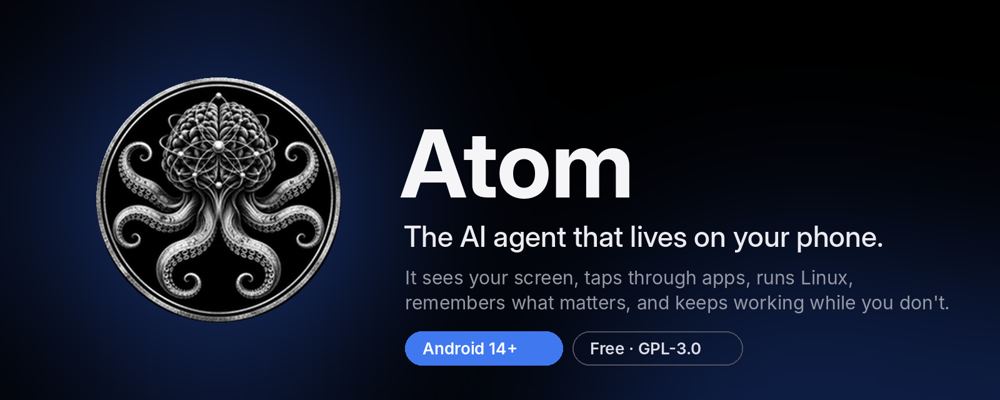
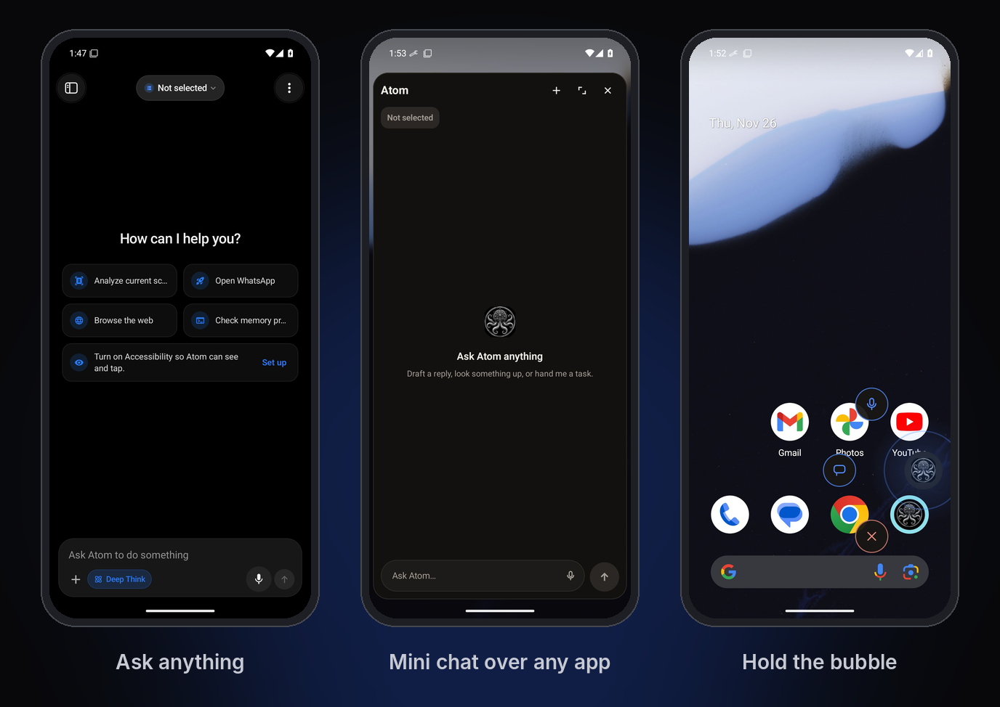
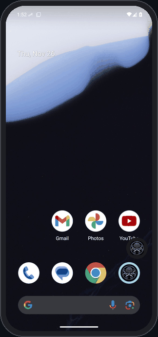
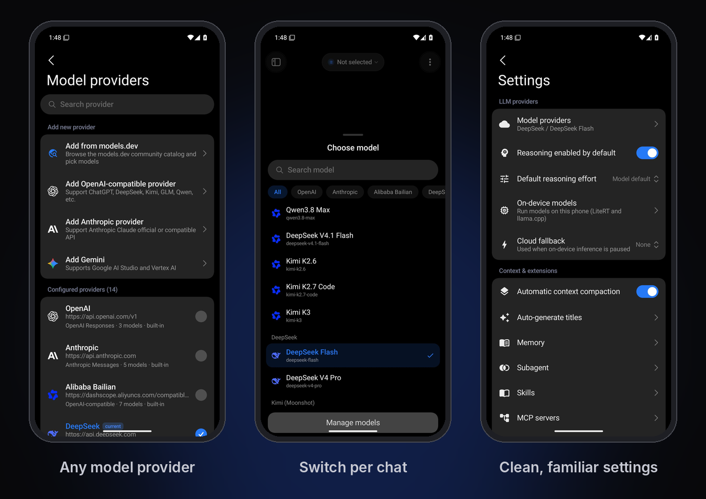
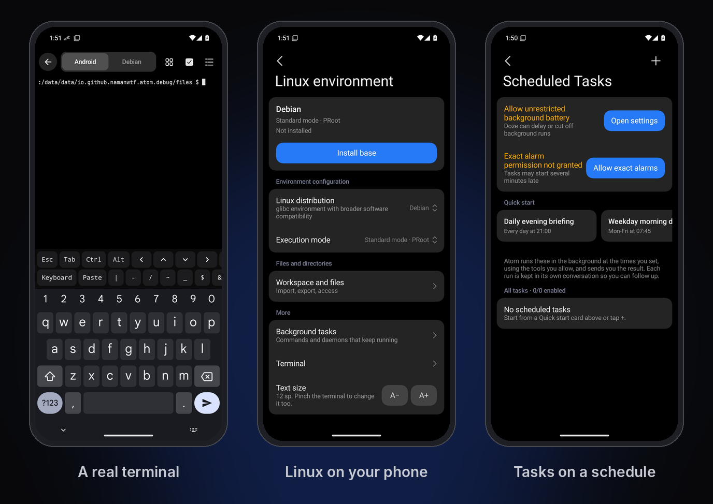
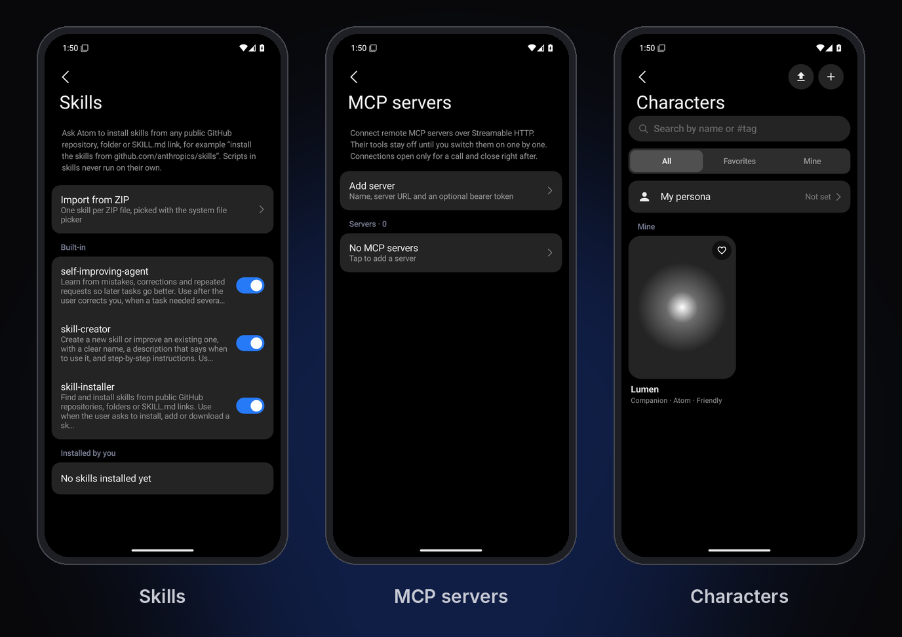

  

  
  
  
  

<b>Chat apps can tell you how to do something. Atom does it.</b> 
It reads your screen, taps through your apps, runs real Linux tools, remembers what matters to you, and keeps working in the background while you get on with your day. On your phone, with the model you choose.

---

  

## Why Atom

Every assistant you use today is a visitor: you open it, type, read the answer and then do the work yourself. Your phone is the one computer that is always with you and already knows your day, and it has no agent of its own.

Atom is that agent. Not a chat window with an API key, but a full agent runtime with real reach into the phone:

- 📱 **It operates apps for you.** It reads what's on screen, taps, types and scrolls, then checks the screen again before it says "done". If it can't confirm something worked, it tells you.
- 🫧 **It's one tap away, everywhere.** A floating bubble sits over any app: tap it for a mini chat, hold it for quick actions, or make Atom your phone's assistant so the assistant gesture opens it already knowing what's on screen.
- 🧠 **It knows your context, when you ask.** Notifications, messages and one-time codes, calendar, contacts, photos, files, location and more, each behind its own Android permission and read only when a task needs it.
- 🐧 **It has a real workbench.** A full terminal and Alpine or Debian Linux on the phone, with Python, Node, git and SSH. Atom writes code, runs it, reads the errors and fixes them.
- ⏰ **It works while you don't.** Scheduled tasks and phone-event automations run in the background and report back: a morning digest, a price watch, a weekly cleanup.
- 🔒 **It stays yours.** No telemetry, no analytics, no accounts. API keys are encrypted with the phone's hardware-backed keystore. Your chats go only to the model you pick, or nowhere at all with an on-device model.

## See it

<table>
<tr>
<td width="34%" align="center" valign="top">
   
  <b>The bubble.</b> Hold it for actions, drag it anywhere, tap it to chat over whatever you're doing. It remembers where you left it.
</td>
<td valign="top">

**Things you can just ask:**

> "Open WhatsApp and tell Rahul I'll be 10 minutes late."

> "What's the OTP that just came in?"

> "Turn on Do Not Disturb until 7 and set an alarm for 6:45."

> "Summarize today's tech news and send me the three most interesting links."

> "Every weekday at 7:45, give me my calendar, the weather and anything urgent in my notifications."

> "Clone this repo, run its tests and tell me why they fail."

> "Look at my screen and explain this error."

</td>
</tr>
</table>

## Bring any model

  

- **Built in:** OpenAI, Anthropic, Gemini (AI Studio and Vertex AI), DeepSeek, Qwen (Alibaba Bailian), Kimi, MiMo, MiniMax, StepFun, SiliconFlow, OpenRouter, xAI, Groq and Mistral.
- **Anything compatible:** any OpenAI- or Anthropic-compatible endpoint, including your own server on the local network, plus the models.dev catalog.
- **Use plans you already pay for:** sign in with a ChatGPT (Codex) or Grok subscription instead of an API key.
- **Fully offline:** on-device models via LiteRT-LM and llama.cpp, with an optional cloud fallback.
- **Think harder when it matters:** reasoning effort per conversation, from Off to Max, limited to what the model supports.

## A workbench in your pocket

  

- A real terminal with multiple sessions, and **Linux on the phone**: Alpine or Debian, in PRoot (no root) or in a chroot (with root).
- Python, Node, SSH, git, ripgrep, jq and APK tools on request. Background commands keep running and notify you when they finish.
- **Device control** with before → after checks: volume, Do Not Disturb, sound mode, flashlight, brightness, toggles, media, alarms and timers. With root or Shizuku it goes deeper: freeze apps, protected settings, logs. Every change lands in an **undo journal**, so you can see what changed and put it back.

## Grows with you

  

- **Memory:** a long-term memory you can read and edit, which Atom keeps up to date itself.
- **Skills:** installable capability packs, from any public GitHub repository.
- **MCP:** connect Model Context Protocol servers and choose exactly which tools Atom may use.
- **Subagents:** Explore, Coder and Plan, plus your own, working in parallel with their own context.
- **Voice:** dictation, hold-to-talk, spoken answers with many voices, and an on-device **"Hey Atom"** wake word.
- **Browser and images:** an agent browser you can take over, web search and page reading, and AI image generation and editing.
- **Characters:** persona chats with character cards, worldbooks and story memory.

## Safe by design

Giving an AI real control of a phone only works if you can trust it, so Atom is built around that:

- **You stay in charge.** Optional "ask before taps and typing", approvals for sensitive actions, per-tool switches that take effect even mid-task, and a Stop button that always works.
- **Locked means locked.** Answers never pop up over the lock screen, and approving an action from there needs your fingerprint or PIN.
- **Honest results.** Atom reports what it confirmed, not what it hoped happened.
- **Open source.** Every line is here to read, under the GPL.

## Get started

1. Download `atom-<version>.apk` from **[Releases](https://github.com/namanwtf/atom/releases/latest)** and install it (Android may ask you to allow installs from your browser).
2. Open Atom, add a model (an API key, a subscription sign-in or an on-device model) and say hello.
3. Optional: turn on the accessibility service so Atom can operate apps, and enable the floating bubble.

Updates arrive inside the app under **Settings → About → Check for updates**, verified before they install.

| | |
|---|---|
| **Android** | 14 or newer |
| **CPU** | ARM64 |
| **Optional extras** | Root (Magisk, KernelSU or APatch), Shizuku or the LSPosed module unlock deeper device control |

Chat, memory, skills, MCP, subagents, scheduled tasks, the terminal, Linux, files and the web need nothing beyond the app.

## FAQ

**Do I need root?** No. Root, Shizuku or LSPosed only add extras such as freezing apps or running cross-app tasks on a hidden screen.

**Does it cost anything?** Atom is free and open source. You pay your model provider (or use a subscription you already have, or a free on-device model).

**Will it drain my battery?** Atom only works when you give it something to do. Background schedules wake it briefly, and animations stop when it's idle.

**Where does my data go?** It stays on your phone, except the messages sent to the model provider you choose. There is no telemetry and no Atom server.

## Building

Atom is built and tested only on GitHub's runners: every pull request runs the unit tests, builds the app and takes screenshots on an Android emulator (see [`.github/workflows`](.github/workflows)). Please don't run the build or tests on a personal machine; use CI.

## License and credits

Atom is free software under the [GNU General Public License v3.0 or later](LICENSE). The license grants no rights to the "Atom" name or logo (GPL-3.0 §7(e)): modified versions must use their own name and branding. See [NOTICE](NOTICE).

Built on great open-source work, including llama.cpp/ggml, LiteRT-LM, OkHttp, Kotlin and kotlinx, Jetpack Compose, Miuix, Shizuku, PRoot, JetBrains Mono and Lobe Icons. Full list with licences in [NOTICE](NOTICE).

<b>If Atom saves you a few taps, a ⭐ helps more people find it.</b>

