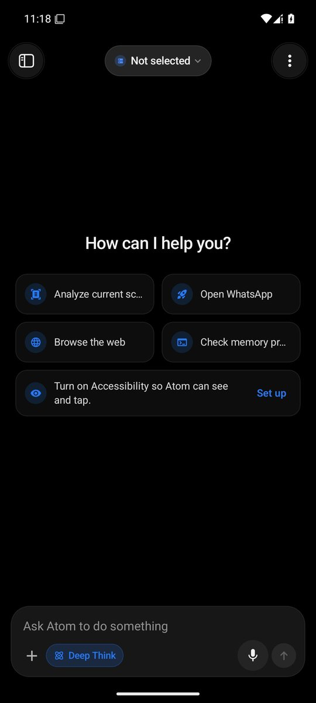
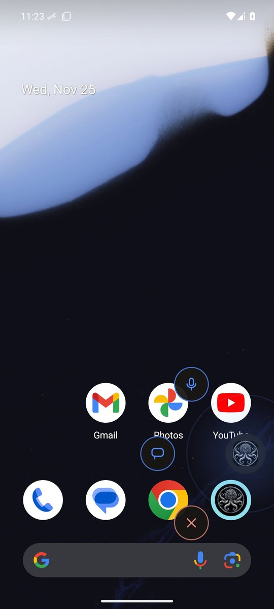
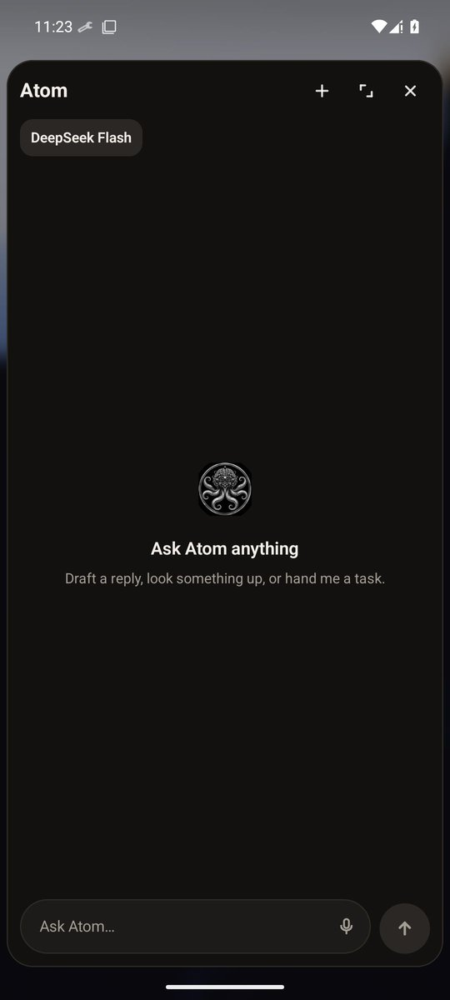
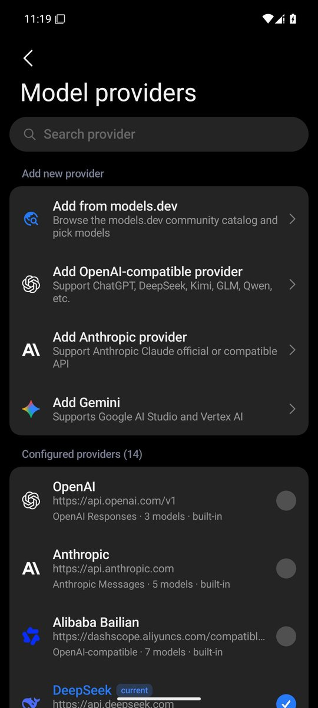
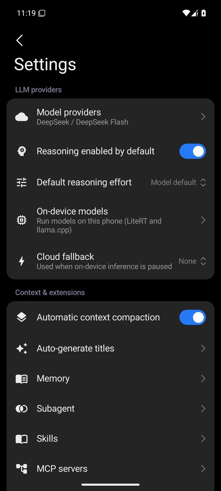
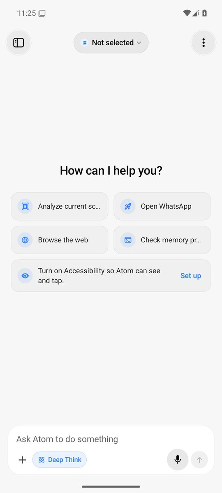

# Atom

**An AI agent that lives on your phone.**

Atom reads the screen, taps through apps, runs commands, remembers what matters and keeps working while you do something else. It runs on the phone itself, talks to the model you choose, and keeps your data between you and that model.

| Home | Hold menu | Mini chat |
| --- | --- | --- |
|  |  |  |

| Model providers | Settings | Light theme |
| --- | --- | --- |
|  |  |  |

Taken on an Android emulator by this repository's CI, on a fresh install with no API key set (hence "Not selected").

---

## What Atom does

### Operates your phone
- Drives apps through Android accessibility: reads the screen, taps, types, scrolls and swipes, then checks the screen again before it reports success. When an action can't be confirmed, Atom says so.
- A run capsule floats over other apps while a task runs: pause, take over, add instructions mid-task or stop. On Android 16 the task also shows as a Live Update in the status bar.
- With root or the LSPosed module, cross-app tasks can run on a hidden virtual display and hand the result back to your screen when you are needed, for example on a payment page or a QR code.

### Is always one tap away
- A floating bubble: tap for a mini chat that runs the full agent, hold for quick actions, drag it anywhere or drop it on the dismiss target.
- Can be your phone's digital assistant: the assistant gesture opens an overlay over the current app that already knows what is on screen.
- Voice in and out: dictation, hold-to-talk, auto-send after a pause, a choice of cloud recognition and speech services with the system voice as fallback, and an on-device **"Hey Atom"** wake word.

### Knows your context, when you ask
Notifications (with a searchable 7-day history kept on the phone), SMS and one-time codes, contacts, call log, calendar (read and write), photos, files, downloads, recordings, location, app usage, device status and health data. Each source needs its own Android permission, which Atom asks for only when a task first needs it, and Atom only reads what a task needs. See [docs/PERMISSIONS.md](docs/PERMISSIONS.md).

### Controls the device
- Volume, Do Not Disturb, sound mode, flashlight, brightness, connectivity toggles, media playback, alarms and timers, each checked before and after.
- With root: freeze, unfreeze and stop apps, protected settings, system logs, private app data (read-only), and more. Rootless phones can use **Shizuku** for many of these.
- Every device change is written to an **undo journal**, so you can see what changed and put it back.

### Has a workbench
- A full terminal with multiple sessions, and Alpine or Debian **Linux on the phone**, running in PRoot without root or in a chroot with root.
- Python, Node, SSH, git, ripgrep, jq, sqlite and APK tools on request. Background commands and services keep running and notify you when they finish.

### Grows with you
- **Memory:** a long-term memory file you can read and edit, which Atom maintains itself.
- **Skills:** installable capability packages, from any public GitHub repository.
- **MCP:** connect Model Context Protocol servers and choose which tools Atom may use.
- **Subagents:** Explore, Coder and Plan, plus your own, running in parallel with their own context.
- **Scheduled tasks and automations:** run Atom on a schedule or on phone events, with quiet hours and notify-on-change.
- **Characters:** persona chats with character cards, worldbooks and story memory.
- **Web and images:** an agent browser you can take over, web search and page reading, and AI image generation and editing with a gallery.

### Works with your model
- Built-in providers: OpenAI, Anthropic, Gemini (AI Studio and Vertex AI), DeepSeek, Alibaba Bailian (Qwen), Kimi, MiMo, MiniMax, StepFun, SiliconFlow, OpenRouter, xAI, Groq and Mistral.
- Any OpenAI-compatible or Anthropic-compatible endpoint, the models.dev catalog, remote model lists and a connection test.
- Sign in with a ChatGPT (Codex) or Grok subscription instead of an API key.
- Reasoning effort per conversation: Off, Low, Medium, High, XHigh or Max, limited to what the model supports.
- **On-device models** (LiteRT-LM and llama.cpp) that work offline, with an optional cloud fallback.

### Coming
- A second interface style (COUI).
- ColorOS-only data sources: notes, orders, bills and system memory.

---

## Requirements

| | |
|---|---|
| Android | 14 or newer |
| CPU | ARM64 |
| Optional | Root (Magisk, KernelSU or APatch), Shizuku, or the LSPosed module, each unlocking more device control |

Chat, memory, skills, MCP, subagents, scheduled tasks, the terminal, Linux, files and the web need nothing beyond the app. Screen control needs the accessibility service.

## Install

Download the APK from [Releases](https://github.com/namanwtf/atom/releases). Releases are built and signed by GitHub Actions when `main` changes.

Installing a newer Atom over an existing one keeps your data and permissions. You never need to uninstall first. Atom checks this repository's Releases from Settings → About and installs an update only after verifying its checksum and signing key; Android asks you to confirm.

## Build

Atom is built and tested only on GitHub's disposable runners: every pull request runs unit tests, builds the debug APK and takes emulator screenshots (see [`.github/workflows`](.github/workflows)). Please don't build or run the test suite on a personal machine: some tests create and delete files, and CI is the supported path.

## Privacy

- No telemetry, no analytics and no tracking SDKs.
- API keys and sign-in tokens are encrypted on the device and never included in backups.
- Your conversations go only to the model provider you configure, or nowhere when you use an on-device model.
- Updates come only from this repository.

## License

Atom is free software under the [GNU General Public License v3.0 or later](LICENSE).

Under GPL-3.0 section 7(e), the license grants no rights to use the "Atom" name or logo: modified versions must use their own name and branding. See [NOTICE](NOTICE).

## Credits

Atom builds on these open-source projects (details and licences in [NOTICE](NOTICE)):

- [llama.cpp / ggml](https://github.com/ggml-org/llama.cpp) (MIT)
- LiteRT-LM and LiteRT by Google (Apache-2.0)
- OkHttp by Square (Apache-2.0)
- Kotlin, kotlinx.coroutines and kotlinx.serialization by JetBrains (Apache-2.0)
- AndroidX and Jetpack Compose by Google (Apache-2.0)
- Shizuku API by RikkaApps (Apache-2.0)
- Haze by Chris Banes (Apache-2.0)
- [PRoot](https://github.com/termux/proot) (GPL-2.0-or-later) and talloc (LGPL-3.0-or-later)
- XZ for Java (0BSD)
