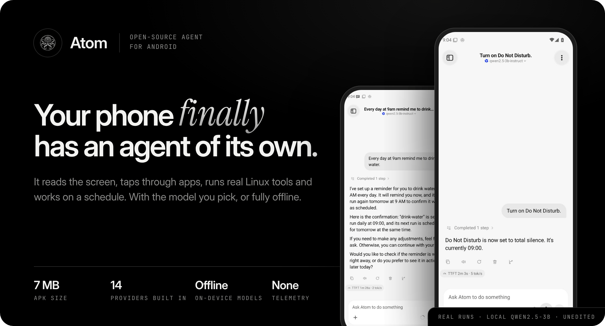
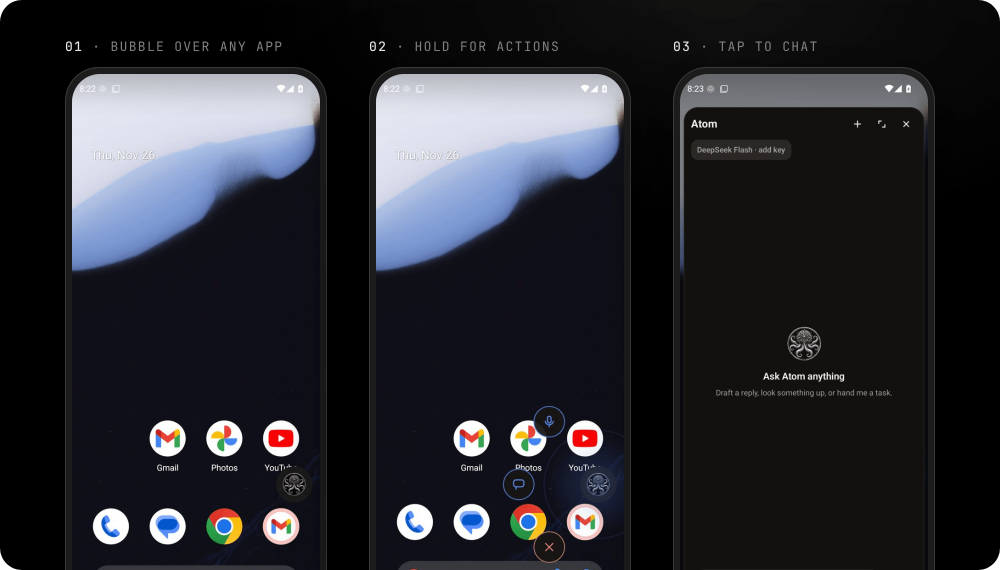
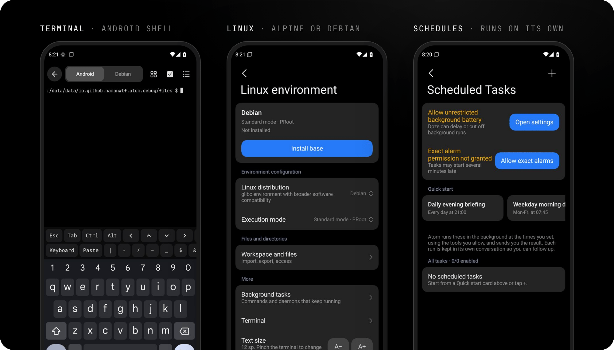
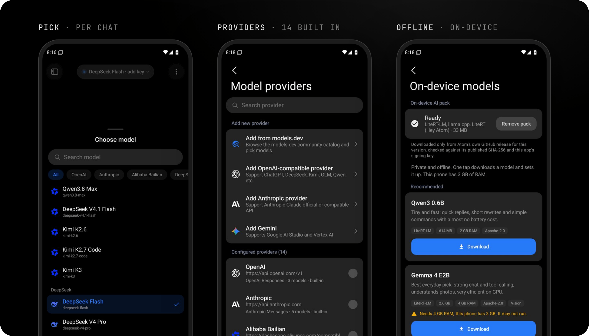
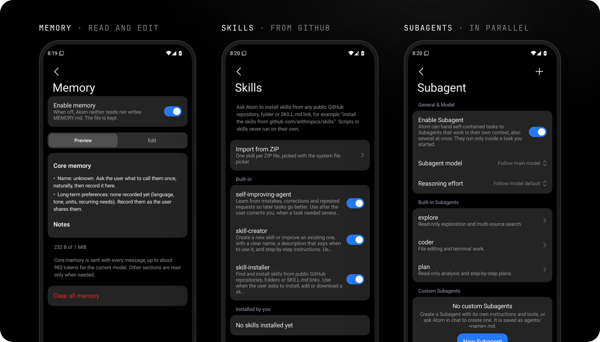
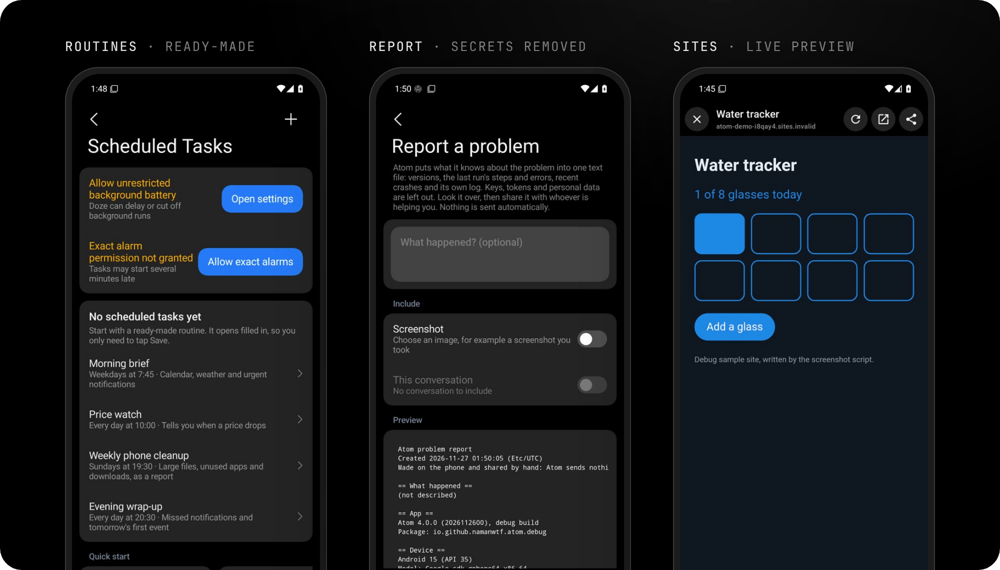

<p align="center">
  <picture>
    <source media="(prefers-color-scheme: dark)" srcset="docs/assets/hero-dark.png">
    <source media="(prefers-color-scheme: light)" srcset="docs/assets/hero-light.png">
    
  </picture>
</p>

<p align="center">
  <a href="https://github.com/namanwtf/atom/releases/latest"></a>
  <a href="https://apps.obtainium.imranr.dev/redirect?r=obtainium://add/https://github.com/namanwtf/atom"></a>
  <a href="https://github.com/namanwtf/atom/stargazers"></a>
</p>

<p align="center">
  <sub><b>Free&nbsp;and&nbsp;open&nbsp;source</b> &nbsp;·&nbsp; GPL&#8209;3.0 &nbsp;·&nbsp; Android&nbsp;14+ &nbsp;·&nbsp; ARM64 &nbsp;·&nbsp; 7&nbsp;MB &nbsp;·&nbsp; No&nbsp;account &nbsp;·&nbsp; No&nbsp;telemetry</sub>
</p>

<!-- DEMO VIDEO SLOT: put docs/assets/demo.gif here (linking to docs/assets/demo.mp4), centred, directly under the buttons. -->

<br>

**Chat apps tell you how to do something. Atom does it.** It reads the screen, taps and types through your apps, and checks the screen again before it says "done". It runs real Linux tools, remembers what matters to you and keeps working in the background. On your phone, with the model you choose.

### Tested on real tasks

Release candidates run these requests on an Android emulator in CI, against a small model (Qwen2.5 3B) on the runner's own CPU. No cloud, no API key. The checks look at the phone, not at the wording.

| You say | What happened, checked on the phone |
|---|---|
| "Turn on Do Not Disturb." | Used its Do Not Disturb tool. DND was on afterwards. |
| "What was my last notification about?" | Read the notifications. Answered: dinner at 8. |
| "Every day at 9am remind me to drink water." | Created a daily scheduled task. |
| "Use the agent browser to open example.com and tell me what it says." | Opened its own browser, read the page, summed it up. |
| A task in Settings, with the screen turned off halfway | Waited for the unlock, then finished. |

All scenarios, including the ones an emulator can't pass: [docs/TESTING.md](docs/TESTING.md).

<br>

## What it does

### 01 &nbsp;It uses your phone the way you do

Atom opens apps, reads the screen, taps, types and scrolls, then looks again to confirm the result. If it can't confirm that something worked, it tells you. A bubble floats over any app: tap it for a mini chat, hold it for quick actions, or make Atom your phone's assistant. When a task needs your context (notifications, messages and one-time codes, calendar, contacts, files, location), Atom asks for that one permission the first time.

<picture>
  <source media="(prefers-color-scheme: dark)" srcset="docs/assets/plate-hands-dark.png">
  <source media="(prefers-color-scheme: light)" srcset="docs/assets/plate-hands-light.png">
  
</picture>

### 02 &nbsp;A real workbench in your pocket

A terminal with several sessions, and Linux on the phone: **Alpine or Debian**, in PRoot (no root needed) or a chroot (with root). Git, SSH, curl, jq and ripgrep come with the base install, and Python and Node are added on request. Atom writes code, runs it, reads the errors and fixes them. Scheduled tasks and phone-event automations run in the background and report back.

<picture>
  <source media="(prefers-color-scheme: dark)" srcset="docs/assets/plate-bench-dark.png">
  <source media="(prefers-color-scheme: light)" srcset="docs/assets/plate-bench-light.png">
  
</picture>

### 03 &nbsp;Any model. Or no cloud at all.

**14 providers built in:** OpenAI, Anthropic, Gemini (AI Studio and Vertex AI), DeepSeek, Qwen (Alibaba Bailian), Kimi, MiMo, MiniMax, StepFun, SiliconFlow, OpenRouter, xAI, Groq and Mistral. Plus **any OpenAI- or Anthropic-compatible endpoint**, such as llama.cpp or Ollama on your own computer. You can sign in with a ChatGPT or Grok subscription instead of an API key. Or go **fully offline** with on-device models (LiteRT-LM and llama.cpp) from an optional 32 MB pack.

<picture>
  <source media="(prefers-color-scheme: dark)" srcset="docs/assets/plate-models-dark.png">
  <source media="(prefers-color-scheme: light)" srcset="docs/assets/plate-models-light.png">
  
</picture>

### 04 &nbsp;It grows with you

**Memory** you can read and edit. **Skills** installed from any public GitHub repo. **MCP** servers, with a switch for each tool. **Subagents** (explore, coder, plan, or your own) that work in parallel. **Voice**: dictation, spoken answers and an on-device "Hey Atom" wake word. An **agent browser** you can take over at any time.

<picture>
  <source media="(prefers-color-scheme: dark)" srcset="docs/assets/plate-extend-dark.png">
  <source media="(prefers-color-scheme: light)" srcset="docs/assets/plate-extend-light.png">
  
</picture>

<br>

## Things you can just ask

```text
"What's the OTP that just came in?"
"Open WhatsApp and tell Rahul I'll be 10 minutes late."
"Turn on Do Not Disturb and set an alarm for 6:45."
"Every weekday at 7:45, give me my calendar and anything urgent in my notifications."
"Look at my screen and explain this error."
"Clone this repo, run its tests and tell me why they fail."
```

## Atom next to a typical chat app

| | Typical chat app | Atom |
|---|---|---|
| Gets it done on your phone (send, toggle, fill in) | You do the taps | Taps for you, then checks the screen |
| Uses what's on your phone | Copy and paste | Reads it when you ask, one permission at a time |
| Runs code | In a remote sandbox, if at all | A terminal and Linux on the phone |
| Works while you're away | No | Schedules and phone-event automations |
| Model | Theirs | 14 providers, any compatible endpoint, or on-device |
| Your data | On their servers | On your phone, plus the provider you pick |

## Private by design

| Stays on your phone | Leaves your phone |
|---|---|
| Chats, memory, files, schedules and the Linux environment | Your messages, to the model provider **you** pick (nothing, with an on-device model) |
| API keys, encrypted with a key held in the Android Keystore | Web searches, to the search engine you set (DuckDuckGo, Bing or Mojeek by default) |
| Notifications, messages, calendar and other context Atom reads | An update check to GitHub, only when you open About or tap Check for updates |

No telemetry, no analytics, no account and no Atom server. Every line of code is here to read.

## You stay in control

- **Approvals.** Optional "ask before taps and typing". Shell commands ask first, and one tap allows them for the rest of that task.
- **Stop always works:** from the chat, the floating run capsule or the notification.
- **Undo.** Every change Atom makes to the device goes into a change history, with one-tap undo.
- **Locked means locked.** Over the lock screen Atom shows only that a task finished. To approve anything, you unlock first.
- **Per-tool switches.** Turn off any tool at any time.

## Honest limits

- **Small models are weak agents.** On-device models from 0.6B to 4B handle chat and simple tool calls. For long, multi-step app tasks, use a strong cloud model.
- **Operating apps goes through Android's accessibility service.** It's slower than your thumb, and apps that hide their screen from accessibility can't be operated.
- **Linux runs in PRoot** when the phone isn't rooted. It's slower than native, and some software won't run.
- **Tested on emulators.** CI covers every change, but battery life and smoothness on real phones aren't measured there. Please [tell us what you see](https://github.com/namanwtf/atom/issues).
- **ARM64 phones on Android 14 or newer**, English interface only.

## What's new

**4.0.5, the current release**

- A frosted side menu.
- Longer tasks: runs keep going while they make progress, and **Continue** picks up a run that reached its step limit.
- One approval per task for shell commands.
- Offline model fixes: prompts that fit small context windows, and no more runaway output.
- Better built-in search: DuckDuckGo Lite, Bing and Mojeek before it gives up, then the agent browser.
- Keeps working with the screen off. Screen tasks wait for you to unlock.

**Coming in 4.0.6**

- **Report a problem:** one tap builds a report on the phone, with keys, tokens and personal data removed. You read it and share it yourself.
- **Ready-made routines:** Morning brief, Price watch, Weekly phone cleanup and Evening wrap-up. Pick one and tap Save.
- **Make me a website:** Atom writes the page and opens a live preview that reloads as it edits.
- **One-tap add key:** tap "add key" on the home screen to go straight to that provider's key screen.

<details>
<summary><b>See 4.0.6 in screenshots</b></summary>
<br>
<picture>
  <source media="(prefers-color-scheme: dark)" srcset="docs/assets/plate-next-dark.png">
  <source media="(prefers-color-scheme: light)" srcset="docs/assets/plate-next-light.png">
  
</picture>
<sub>From the 4.0.6 test build. The sample site in the preview was written by the screenshot script.</sub>
</details>

## Install in 3 steps

1. **Get it.** Download `atom-<version>.apk` from **[Releases](https://github.com/namanwtf/atom/releases/latest)**, or add Atom to **[Obtainium](https://apps.obtainium.imranr.dev/redirect?r=obtainium://add/https://github.com/namanwtf/atom)** so it picks up new releases for you.
2. **Add a model.** Open Atom and paste an API key, sign in with a subscription, or download an on-device model.
3. **Let it act (optional).** Turn on Atom's accessibility service so it can operate apps, and switch on the floating bubble.

Updates also arrive inside the app (**Settings → About → Check for updates**). Each one is checked against its published SHA-256 and Atom's signing certificate before it installs. Atom isn't on Google Play, on purpose; an IzzyOnDroid listing is planned.

<details>
<summary><b>Permissions</b></summary>
<br>

Atom asks for each permission the first time a feature needs it, and works without the optional ones. The full list, with what uses each one and when it's asked, is in [docs/PERMISSIONS.md](docs/PERMISSIONS.md).

| Feature | What it needs |
|---|---|
| Chat, memory, skills, MCP, subagents, schedules, terminal, Linux, web | Nothing beyond the app |
| Operating apps, reading the screen | Accessibility service |
| Floating bubble and run capsule | Display over other apps |
| Personal context (messages, calendar, location…) | That source's own Android permission, asked on first use |
| Deeper device control (freeze apps, system settings, logs) | Root (Magisk, KernelSU, APatch) or Shizuku |
| Hidden-screen tasks, system assistant extras | Root or the LSPosed module |

</details>

<details>
<summary><b>FAQ</b></summary>
<br>

**Do I need root?** No. Root, Shizuku or LSPosed only add extras, such as freezing apps or running tasks on a hidden screen.

**Does it cost anything?** Atom is free. You pay your model provider, use a subscription you already have, or run a free on-device model.

**Will it drain my battery?** Atom works only when you give it something to do. Schedules wake it briefly, and animations stop when it's idle.

**Why isn't it on Google Play?** That's deliberate. Atom ships from here: GitHub Releases, the in-app updater and Obtainium, with IzzyOnDroid planned.

**Where does my data go?** See [Private by design](#private-by-design).

</details>

<details>
<summary><b>Building and contributing</b></summary>
<br>

Atom is built and tested only on GitHub's runners. Every pull request runs the unit tests, builds the app and takes screenshots on an Android emulator, so you can see your change running without a phone (see [`.github/workflows`](.github/workflows)). Please use CI rather than building on a personal machine.

Issues and pull requests are welcome. More docs: [IMPORT.md](docs/IMPORT.md) (moving from an earlier install), [UPDATES.md](docs/UPDATES.md) (releases and in-app updates), [TESTING.md](docs/TESTING.md) and [PARITY_SPEC.md](docs/PARITY_SPEC.md) (the full feature checklist).

</details>

## License and credits

Atom is free software under the [GNU General Public License v3.0 or later](LICENSE). The license grants no rights to the "Atom" name or logo (GPL-3.0 §7(e)): modified versions must use their own name and branding. See [NOTICE](NOTICE).

Built on great open-source work, including llama.cpp/ggml, LiteRT-LM, OkHttp, Kotlin and kotlinx, Jetpack Compose, Miuix, Haze, Shizuku, PRoot, JetBrains Mono and Lobe Icons. The full list, with licences, is in [NOTICE](NOTICE).

<p align="center"><br><br><sub>If Atom saves you a few taps, a star helps other people find it.</sub></p>
